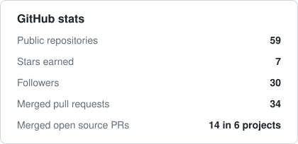
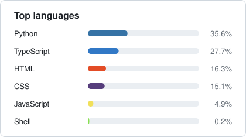
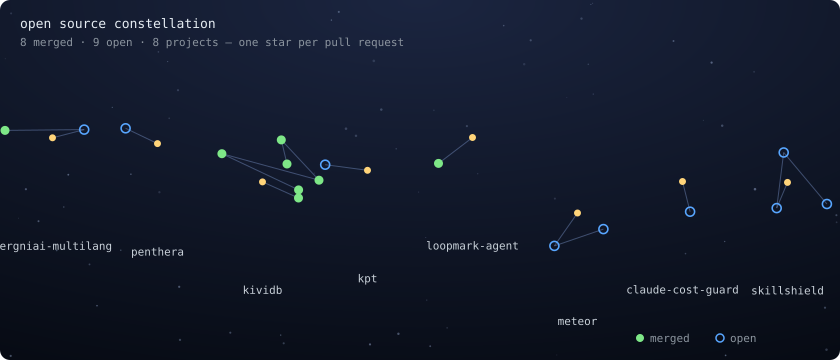

I build **applied AI products end to end**, and my main project right now is **[Mooose](https://github.com/matheussilvano/mooose)**, an open-source ENEM essay grader: LLM orchestration, RAG pipelines, FastAPI services, and the observability that keeps them honest in production. I work at Dígitro Tecnologia, ship SaaS on the side, and study Information Systems at UFSC.

📍 Florianópolis, Brazil &nbsp;·&nbsp; 🎓 Information Systems @ UFSC (2024–2028) &nbsp;·&nbsp; 🗣️ Portuguese (native) · English (B2) · Spanish (B1)

---

## ⭐ Flagship project: Mooose

**[Mooose](https://github.com/matheussilvano/mooose) is the open-source ENEM essay grader I build in public.** ENEM is Brazil's national exam, and millions of students train essays with nobody to grade them. Mooose grades each of the five official competencies, explains how to improve, and runs on whatever LLM you bring: free OpenRouter models, Gemini, Groq, a local Ollama, OpenAI or Claude. The hosted version has graded **1,000+ essays**.

What makes it interesting as an AI engineering project:

- **LangGraph pipeline**: theme analysis, five specialist graders in parallel, a reviewer that can move a score by at most one level, deterministic calibration, then synthesis.
- **LLM + rules, on purpose**: ENEM annulment rules, tangency caps and the Competency 5 score (computed from an agent/action/means/purpose checklist) are unit-tested Python, not model opinion.
- **Self-consistency**: sample each competency N times and take the median, which steadies free and small models.
- **Provider-agnostic**: bring-your-own-key API with SSE progress streaming; structured output that works without tool calling, so it runs on free and local models.
- **Measured, not guessed**: offline tests with a scripted fake LLM (29 backend + 9 frontend tests, CI on every push), an eval harness, and prompt-injection hardening.
- **Photo input**: handwriting read by a vision model (a free one worked), with local PaddleOCR as an option.

<table>
  <tr>
    <td></td>
    <td></td>
  </tr>
</table>

[⭐ Star it](https://github.com/matheussilvano/mooose) &nbsp;·&nbsp; [🌐 Project page](https://mooose.matheussilvano.workers.dev) &nbsp;·&nbsp; [🧩 Good first issues](https://github.com/matheussilvano/mooose/issues?q=is%3Aopen+label%3A%22good+first+issue%22) &nbsp;·&nbsp; [💖 Sponsor](https://github.com/sponsors/matheussilvano)

---

## 📊 By the numbers

<table>
  <tr>
    <td></td>
    <td></td>
  </tr>
</table>

Self-hosted: both cards are generated daily by [a workflow](.github/workflows/stats.yml) from the GitHub API. No third-party widget, nothing to go down.

## 🌌 Open source constellation

Every pull request I send to a project that isn't mine becomes a star. Stars from the same project form a constellation. Green is merged, blue and pulsing is still open. Hover a star to see which PR it is.

  

<b>Latest contributions</b> (auto-updated)

<!-- PRS:START -->
**Merged: 14 in 6 projects**

| Project | Pull request | Merged |
|---|---|---|
| [voyager-browser/voyager](https://github.com/voyager-browser/voyager) | [feat(shortcuts): focus the address bar with Alt+D](https://github.com/voyager-browser/voyager/pull/95) | 2026-11-04 |
| [Snorlark/plop-ui](https://github.com/Snorlark/plop-ui) | [feat(react): add a name prop to Select and MultiSelect](https://github.com/Snorlark/plop-ui/pull/130) | 2026-11-05 |
| [kividbio/kividb](https://github.com/kividbio/kividb) | [LangGraph harness: drop only this run's indexes](https://github.com/kividbio/kividb/pull/343) | 2026-11-04 |
| [kividbio/kividb](https://github.com/kividbio/kividb) | [Mem0 harness: Redis vector store and the Memory API](https://github.com/kividbio/kividb/pull/342) | 2026-11-04 |
| [kividbio/kividb](https://github.com/kividbio/kividb) | [LlamaIndex harness: drop only this run's indexes, and correct the report](https://github.com/kividbio/kividb/pull/341) | 2026-11-04 |
| [kividbio/kividb](https://github.com/kividbio/kividb) | [LlamaIndex harness: Redis vector store, docstore, index store and kv store](https://github.com/kividbio/kividb/pull/334) | 2026-11-04 |
| [danoszz/penthera](https://github.com/danoszz/penthera) | [fix(report): read the Markdown report version from package.json](https://github.com/danoszz/penthera/pull/244) | 2026-11-04 |
| [kividbio/kividb](https://github.com/kividbio/kividb) | [LangChain harness: remove the indexes it creates](https://github.com/kividbio/kividb/pull/330) | 2026-11-03 |
| [kividbio/kividb](https://github.com/kividbio/kividb) | [LangGraph compatibility: a harness, its results against KiviDB and Redis 8, and a docs page](https://github.com/kividbio/kividb/pull/329) | 2026-11-03 |
| [kividbio/kividb](https://github.com/kividbio/kividb) | [LangChain compatibility: a harness, its results against KiviDB and Redis 8, and a docs page](https://github.com/kividbio/kividb/pull/325) | 2026-11-03 |
| [kividbio/kividb](https://github.com/kividbio/kividb) | [CONFIG SET latency-tracking-info-percentiles refuses what Redis refuses](https://github.com/kividbio/kividb/pull/323) | 2026-11-03 |
| [kividbio/kividb](https://github.com/kividbio/kividb) | [Add SCRIPT HELP](https://github.com/kividbio/kividb/pull/318) | 2026-11-03 |

**In review: 15**

| Project | Pull request |
|---|---|
| [langgenius/dify](https://github.com/langgenius/dify) | [refactor(api): use explicit sessions in ApiToolManageService](https://github.com/langgenius/dify/pull/45587) |
| [BerriAI/litellm](https://github.com/BerriAI/litellm) | [fix(complexity_router): give Claude Code subagents their own tier pin](https://github.com/BerriAI/litellm/pull/50108) |
| [scylladb/scylla-rust-driver](https://github.com/scylladb/scylla-rust-driver) | [docs: add a chapter and an example for CachingSession](https://github.com/scylladb/scylla-rust-driver/pull/2021) |
| [RadioAstronomySoftwareGroup/pyuvdata](https://github.com/RadioAstronomySoftwareGroup/pyuvdata) | [List the antennas that are not in antenna_numbers in the UVData.check error](https://github.com/RadioAstronomySoftwareGroup/pyuvdata/pull/1744) |
| [redis/mcp-redis](https://github.com/redis/mcp-redis) | [Read messages that follow the subscribe confirmation](https://github.com/redis/mcp-redis/pull/203) |
| [redis/mcp-redis](https://github.com/redis/mcp-redis) | [Keep one Redis client per decode_responses mode](https://github.com/redis/mcp-redis/pull/202) |
| [obielin/skillshield](https://github.com/obielin/skillshield) | [Flag Unicode tag characters and scan the text they hide](https://github.com/obielin/skillshield/pull/91) |
| [obielin/skillshield](https://github.com/obielin/skillshield) | [Flag the whole environment sent over HTTP in SG-002](https://github.com/obielin/skillshield/pull/90) |
| [Terngi-AI/tergniai-multilang](https://github.com/Terngi-AI/tergniai-multilang) | [feat(chat): N-ATLaS as a native chat provider, answering without the English round trip](https://github.com/Terngi-AI/tergniai-multilang/pull/135) |
| [obielin/skillshield](https://github.com/obielin/skillshield) | [Flag curl/wget piped into a shell in SG-006](https://github.com/obielin/skillshield/pull/89) |
| [obielin/skillshield](https://github.com/obielin/skillshield) | [Fail folder scans on HIGH files and unreadable files](https://github.com/obielin/skillshield/pull/88) |
| [kptdev/kpt](https://github.com/kptdev/kpt) | [Add --format json to kpt pkg tree](https://github.com/kptdev/kpt/pull/4847) |

[Every merged pull request, on GitHub →](https://github.com/search?q=author%3Amatheussilvano%20is%3Apr%20is%3Amerged%20is%3Apublic%20-user%3Amatheussilvano&type=pullrequests)
<!-- PRS:END -->

## 💬 Ask my resume

No chatbot to sign up for. Click a question, press **Submit new issue**, and within seconds a tiny retrieval bot (BM25 over my resume, **no LLM, no API keys**, [source](scripts/answer_question.py)) replies in the thread.

| | |
|---|---|
| [Does he know RAG?](https://github.com/matheussilvano/matheussilvano/issues/new?template=ask.yml&title=ask%3A+Does+he+know+RAG%3F) | [What did he build for telephony?](https://github.com/matheussilvano/matheussilvano/issues/new?template=ask.yml&title=ask%3A+What+did+he+build+for+telephony%3F) |
| [How does he evaluate LLMs?](https://github.com/matheussilvano/matheussilvano/issues/new?template=ask.yml&title=ask%3A+How+does+he+evaluate+LLMs%3F) | [What is Smart Pricing?](https://github.com/matheussilvano/matheussilvano/issues/new?template=ask.yml&title=ask%3A+What+is+Smart+Pricing%3F) |
| [What is his tech stack?](https://github.com/matheussilvano/matheussilvano/issues/new?template=ask.yml&title=ask%3A+What+is+his+tech+stack%3F) | [Ask your own question →](https://github.com/matheussilvano/matheussilvano/issues/new?template=ask.yml) |

---

## 💼 Experience

<b>AI Developer — Dígitro Tecnologia</b> · Feb 2026 – now · Florianópolis (on-site)

- Enterprise **generative AI** with LLMs and orchestration patterns (tools, routing, memory, fallback) to automate internal flows.
- End-to-end **RAG**: ingestion and normalization, chunking, embeddings, vector store and **re-ranking**, to raise precision and cut hallucinations in production.
- **FastAPI** services between LLMs and internal APIs, with schemas, versioning and error handling.
- **Telephony bots**: call-transfer flows and emergency-call classification, integrated with IVR systems.
- No-code-driven **agents that generate IVR code and configuration** (FastAPI + LangChain), cutting delivery time by about 2 days.
- Internal **LLM evaluation framework** (quality, cost and latency; models, embeddings and re-rankers) and **observability** (structured logs, per-request tracing, latency/cost metrics).
- Scrum Master for the team: prioritization, unblocking and stakeholder alignment.

*Previously AI Developer Intern at Dígitro (Apr 2025 – Jan 2026): VoIP call diagnosis with LLMs, re-ranking evaluation pipeline, model endpoints and test datasets.*

<b>Full Stack & AI Developer — Smart Pricing</b> · Nov 2025 – now · Remote (contract)

- Built and shipped a **SaaS for vacation-rental hosts** (Python/React) covering pricing, occupancy and performance for portfolios of **30+ properties**.
- **Multi-tenant FastAPI REST API**, React dashboards, pricing automations (unbooked-day and occupancy-gap rules), and ADR / occupancy / REVPAR metrics.
- Alerts for negative reviews, scheduled metric jobs, and an **AI proof of concept** for automatic insights per property.

<b>AI & Automations Developer — Fonte</b> · Feb – Apr 2026 · Remote (contract)

- **n8n** workflow over the WhatsApp Cloud API, OpenAI and Trello that turns group messages into structured, validated tasks, with Redis duplicate control, automatic deadlines and error handling.

<b>Nexxera</b> · Implementation Operator (Dec 2023 – Apr 2025) · Implementation Apprentice (Jan 2022 – Dec 2023)

- Automated implementation routines and validations with **Python and Shell Script**; audited corporate data with **SQL**.

---

## 🌟 Featured projects

| Project | What it is | Stack |
|---|---|---|
| **[Mooose](https://github.com/matheussilvano/mooose)** ⭐ | Open-source ENEM essay grader: LangGraph pipeline with five specialist graders, rule-based calibration, bring-your-own LLM (free options included). **1,000+ essays graded** on the hosted version. | Python · FastAPI · LangGraph · LangChain · React · Docker |
| **[Real-time face recognition](https://github.com/matheussilvano/real-time-face-recognitor)** | Local face detection and identification in real time. | Python · OpenCV · NumPy |
| **[Toxic content detector](https://github.com/matheussilvano/toxic-content-detector)** | Comment classification pipeline with a simple UI for testing. | Python · scikit-learn · pandas · Streamlit |
| **[Limpa CNPJ](https://github.com/matheussilvano/limpa-cnpj)** | Chrome extension with **170+ active users**. | JavaScript · HTML · CSS |

---

## 🛠️ Tech I work with

**AI:** LLMs · RAG · embeddings · re-ranking · prompt engineering · model evaluation · observability &nbsp;|&nbsp; **Data:** PostgreSQL · pgvector · Qdrant · Redis · Oracle · MySQL &nbsp;|&nbsp; **Ops:** Docker · CI/CD · Grafana · Render · Vercel

🏅 Google AI Essentials · Databricks Generative AI Fundamentals · OBMEP honorable mention (2019, 2022) · ONC silver medal (2022)

---

Everything on this page is generated from this repository: the header, the stats, the constellation and the answers are plain SVG, Python and GitHub Actions. <a href="https://github.com/matheussilvano/matheussilvano">Fork it.</a>

